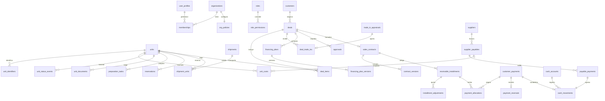

# Motor Haus · Dominios y modelo de datos

## Dominios funcionales

| # | Dominio | Pantallas | Tablas principales |
|---|---|---|---|
| 1 | Executive Command | `/` | vistas y `executive_snapshot`, `management_alerts`, `receivables_aging`, `cash_projection` |
| 2 | Inventory & Showroom | `/inventory`, `/inventory/[id]` | `units`, `unit_identifiers`, `unit_costs`, `unit_status_events`, `unit_price_history`, `unit_locations`, `unit_documents`, `unit_media`, `physical_counts` |
| 3 | Import & Logistics | `/imports` | `suppliers`, `purchase_orders`, `purchase_order_lines`, `shipments`, `shipment_units`, `import_events` |
| 4 | CRM & Client Intelligence | `/customers` | `customers`, `customer_interactions`, `leads`, `sales_opportunities` |
| 5 | Sales & Deal Desk | `/deals` | `deals`, `deal_items`, `deal_trade_ins`, `financing_plans`, `financing_plan_versions` |
| 6 | Trade-In & Appraisals | `/appraisals` | `trade_in_appraisals`, `appraisal_inspections`, `appraisal_costs` |
| 7 | Contracts & Reservations | `/contracts` | `reservations`, `sales_contracts`, `contract_versions` |
| 8 | Accounts Receivable | `/receivables` | `receivable_installments`, `installment_adjustments`, `collection_actions`, `notification_events` |
| 9 | Payments & Treasury | `/payments`, `/treasury` | `customer_payments`, `payment_allocations`, `payment_reversals`, `cash_accounts`, `cash_movements`, `bank_reconciliations`, `exchange_rates` |
| 10 | Financing & Deal Economics | Mesa | `src/domain/finance`, `app.deal_economics`, `app.validate_schedule` |
| 11 | Supplier Accounts Payable | `/payables` | `supplier_payables` (facturas), `payable_payments` |
| 12 | Vehicle Preparation & Service | `/service` | `service_orders`, `inspections`, `preparation_tasks`, `preparation_templates` |
| 13 | Profitability & Reports | `/reports` | consultas sobre contratos y costes congelados al formalizar |
| 14 | Documents & Approvals | `/documents`, `/approvals` | `document_templates`, `documents`, `approvals`, `number_sequences` |
| 15 | Audit & Administration | `/audit`, `/admin` | `audit_events`, `org_policies`, `org_holidays`, `cost_concepts`, `status_transitions`, `memberships`, `roles`, `permissions`, `sales_targets` |

> Notas de nomenclatura: las facturas de proveedor (*supplier_invoices*) y su saldo se modelan en una sola tabla `supplier_payables`; las aprobaciones de tasaciones (*appraisal_approvals*) usan la tabla genérica `approvals` con `entity_type = 'trade_in_appraisal'`.

## Relaciones centrales

## Saldos derivados (nunca editables)

| Vista | Definición |
|---|---|
| `installment_status` | `total_due = amount_due + Σ ajustes`; `paid_confirmed = Σ asignaciones de pagos confirmados`; `outstanding = total_due − paid_confirmed`; vencida si `hoy > fecha_exigible + gracia`; atraso desde la fecha exigible |
| `contract_balances` | Agregado por contrato + control `schedule_discrepancy = Σ principal programado − (entregas + capital financiado)` (debe ser 0) |
| `payment_status` | Importe asignado y sin asignar por pago |
| `payable_status` | Pagado = Σ pagos no revertidos; vencida por fecha |
| `cash_account_balances` | Saldo inicial + movimientos contabilizados ≤ hoy; pendientes aparte; `data_origin = manual` |
| `unit_overview` | Estado visible derivado de los cuatro estados, días en stock, costes reales/estimados (NULL sin permiso), margen potencial |

## Estados de unidad

Cuatro dimensiones independientes con flujo configurable (`status_transitions`):

- **Adquisición:** evaluation → approved → acquired (o rejected)
- **Logística:** pending → in_transit ⇄ in_customs → received *(recepción solo por `receive_unit`)*
- **Preparación:** not_started → in_preparation ⇄ in_service, ready *(ready exige tareas obligatorias completas)*
- **Comercial:** not_listed → available ⇄ reserved → sold_pending_delivery → delivered; retired *(reserva, venta y entrega solo por funciones; available exige adquisición, recepción, preparación lista, documentos obligatorios, precios y ubicación)*

## Concurrencia

- `reservations_one_active_idx` (índice único parcial) + `SELECT … FOR UPDATE` sobre la unidad.
- `formalize_deal` bloquea unidades en orden de id para evitar interbloqueos y revalida disponibilidad.
- Asignaciones y confirmaciones bloquean cuotas; la confirmación rechaza sobrecobro si otro pago cubrió la cuota.
- Concurrencia optimista (`row_version`) para precios y términos de negociación.
- Idempotencia de pagos (`idempotency_key` única) y unicidad de referencia bancaria por cuenta.
- Numeración sin huecos por transacción (`number_sequences` con bloqueo de fila).
